# BoxLift — vẽ khung 2D trên ảnh, ra box 3D trong CVAT

   

**BoxLift** là extension Chrome chạy trên job 3D của CVAT. Annotator **kéo một khung 2D quanh vật thể trên ảnh camera**,
extension lấy điểm LiDAR nằm trong khung đó và **dựng sẵn cuboid 3D** (kích thước, hướng, độ cao). Bấm `Enter` là box
được lưu thẳng vào job CVAT đang mở. Mọi thứ chạy trong trình duyệt của bạn, **không gửi dữ liệu ra ngoài**.

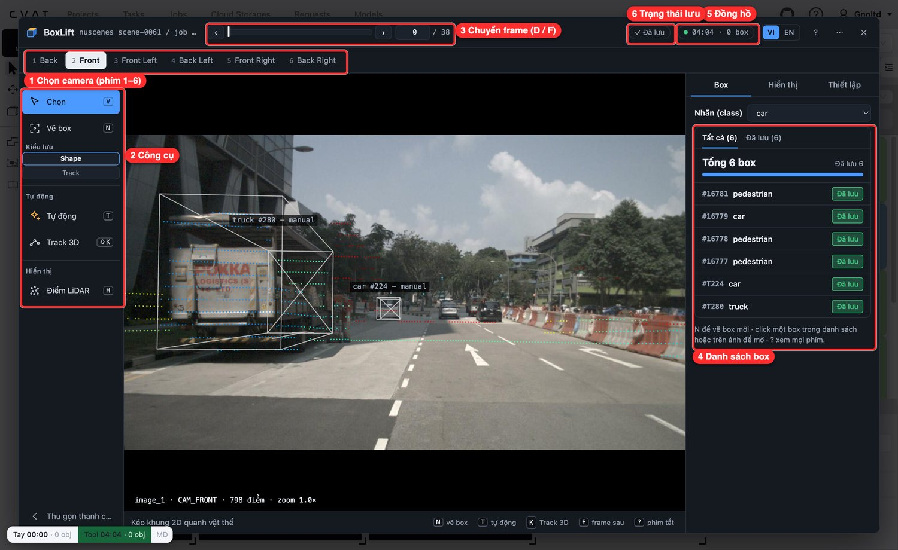

> **Tải ngay:** [Releases → `calib-overlay-v1.0.0.zip`](https://github.com/Gnoltd/boxlift/releases/latest) · cài theo [Cài đặt extension](#cài-đặt-extension) (khoảng 2 phút).

> **Vấn đề:** gán cuboid 3D phải đối chiếu ảnh camera 2D với điểm 3D bằng
> mắt, hơn 30 phút mỗi frame. Đề tài N1-01B: cuboid từ bbox 2D chiếu sang LiDAR (frustum).

## Mục lục

- [Dùng thử trên web](#dùng-thử-trên-web)
- [Tính năng chính](#tính-năng-chính)
- [Cần chuẩn bị](#cần-chuẩn-bị)
- [Cài đặt extension](#cài-đặt-extension)
- [Hướng dẫn sử dụng](#hướng-dẫn-sử-dụng)
  - [Bước 1. Mở BoxLift trên job 3D](#bước-1-mở-boxlift-trên-job-3d)
  - [Bước 2. Làm quen màn hình chính](#bước-2-làm-quen-màn-hình-chính)
  - [Bước 3. Kéo khung 2D để dựng box 3D](#bước-3-kéo-khung-2d-để-dựng-box-3d)
  - [Bước 4. Chỉnh và lưu box](#bước-4-chỉnh-và-lưu-box)
  - [Bước 5. Để máy tự đề xuất box (T / Shift+T)](#bước-5-để-máy-tự-đề-xuất-box-t--shiftt)
  - [Bước 6. Track 3D: bám vật thể qua nhiều frame](#bước-6-track-3d-bám-vật-thể-qua-nhiều-frame)
  - [Bước 7. Đo thời gian làm việc](#bước-7-đo-thời-gian-làm-việc)
- [Phím tắt cần nhớ](#phím-tắt-cần-nhớ)
- [Xử lý sự cố thường gặp](#xử-lý-sự-cố-thường-gặp)
- [Độ chính xác đã đo](#độ-chính-xác-đã-đo)
- [Giới hạn hiện tại](#giới-hạn-hiện-tại)
- [Hướng phát triển](#hướng-phát-triển)
- [Dành cho người phát triển](#dành-cho-người-phát-triển)
- [Ghi công và giấy phép](#ghi-công-và-giấy-phép)

## Dùng thử trên web

Demo: https://boxlift-demo.vercel.app (mở bằng Chrome trên máy tính)

Bản demo chạy ngay trên trình duyệt, không cần cài extension hay CVAT. Trang chạy **nguyên mã extension** trên một job giả
gồm **10 frame của Argoverse 2** (log `av2-20dd185d`, 7 camera + LiDAR).

- Chỉ hỗ trợ **Chrome desktop** (hoặc trình duyệt nhân Chromium, cửa sổ rộng từ 1000 px).
- Mở trang là thấy ngay màn hình 3D của point cloud (xoay, phóng to được). Hướng dẫn 7 bước, có khoanh sáng đúng nút cần dùng: màn hình 3D, mở BoxLift, ảnh camera với điểm LiDAR chiếu lên, vẽ box (`N`), để máy đề xuất (`T`), theo dõi qua các frame (`Shift+K`), rồi tự do thử.
- Lần mở đầu tải khoảng 60 MB dữ liệu, sau đó khoảng 129 MB mô hình AI tải ngầm (chip ở góc trên bên phải báo tiến độ). WebGPU không bắt buộc.
- Box bạn vẽ chỉ lưu trong trình duyệt này (nút "Đặt lại demo" để xoá), không gửi đi đâu.
- Giới hạn: dữ liệu mẫu đóng gói sẵn, không mở được job CVAT thật. Console có thể hiện một lỗi 404 của `/ext/config/database.json`: đây là bình thường vì demo không có cấu hình Supabase.

Chạy cục bộ:

```bash
MODEL_BASE=<url thư mục chứa các tệp .onnx> node tools/build-web.js   # hoặc --model-base <url>
npx serve web/dist   # hoặc bất kỳ máy chủ tĩnh nào; cần rewrite /tasks/* về /index.html để tải lại trang không bị 404
```

Deploy lên Vercel: import repo, đặt biến môi trường `MODEL_BASE` (bắt buộc, build sẽ báo lỗi nếu thiếu). `vercel.json` đã khai
báo build, thư mục `web/dist`, rewrite và header cache.

Dữ liệu mẫu: Argoverse 2 Sensor Dataset, giấy phép [CC BY-NC-SA 4.0](https://creativecommons.org/licenses/by-nc-sa/4.0/)
(đã chọn 10 trong 100 frame, ảnh đóng lại thành `.ctx`; chi tiết trong [`web/demo-data/NOTICE.md`](web/demo-data/NOTICE.md)). Demo miễn phí, phi thương mại.

## Tính năng chính

| Tính năng | Làm gì | Phím |
|---|---|---|
| **Khung 2D → box 3D** | Kéo khung quanh vật thể trên ảnh camera, box 3D hiện ra ngay, kể cả phần xe bị khuất | `N` rồi kéo |
| **Tự động** | Mô hình nhận diện (YOLOX-S) tự khoanh xe / người trên ảnh, mỗi khung thành một box để bạn duyệt | `T` (1 camera) · `Shift+T` (mọi camera) |
| **Track 3D** | Bấm một lần, box bám vật thể qua nhiều frame và giữ nguyên ID | `Shift+K` |
| **Chỉnh nhanh** | Kéo tay cầm trên ảnh, 3 khung nhìn Trên / Hông / Trước, hoặc dời bằng phím mũi tên | `←↑↓→` `[` `]` |
| **Đo thời gian** | Đồng hồ **Tay** và **Tool** tự chạy, xuất bảng so sánh Làm tay vs Dùng tool | tự động |
| **Hai ngôn ngữ** | Giao diện tiếng Việt và tiếng Anh, bật bằng nút `VI` / `EN` | |

Mô hình theo loại vật thể (từ bản 0.19): xe con dùng **MTrans** (ảnh + LiDAR, cần WebGPU); xe tải, buýt, xe đạp, người
dùng **Frustum PointNet** (chỉ LiDAR); xe máy và các trường hợp dự phòng dùng gom cụm hình học.

## Cần chuẩn bị

- **Google Chrome** (hoặc trình duyệt nhân Chromium) bản mới. Nên có WebGPU để dùng MTrans; kiểm tra tại `chrome://gpu`.
- **Một CVAT** có job 3D (point cloud kèm ảnh camera): CVAT chạy local `http://localhost:8080` hoặc `https://app.cvat.ai`.
  CVAT ở domain khác vẫn dùng được, xem [Xử lý sự cố](#xử-lý-sự-cố-thường-gặp).
- **Calib camera ↔ LiDAR** của dữ liệu. Có sẵn trong extension cho 10 cảnh nuScenes-mini và KITTI 2011_09_26; extension
  tự chọn calib theo **tên task** (tên task chứa tên cảnh, ví dụ `nuscenes scene-0061`). Dữ liệu khác thì nạp file
  `calib.json` trong BoxLift.
- Khoảng **150 MB** trống cho file release (đã gồm toàn bộ mô hình).

## Cài đặt extension

Extension chưa lên Chrome Web Store nên cài bằng chế độ nhà phát triển. Mất khoảng 2 phút.

**1. Tải bản release.** Mở trang [**Releases**](https://github.com/Gnoltd/boxlift/releases/latest) của repo này, tải file
**`calib-overlay-vX.Y.Z.zip`** ở mục *Assets* của bản mới nhất.

> Chọn đúng file `calib-overlay-v….zip`. File zip này đã đóng gói sẵn các mô hình `.onnx` (`frustum_box`, `frustum_seg`,
> `heading`, `mtrans`, `yolox_s`). Không dùng nút *Source code (zip)* của GitHub vì bản đó **không có mô hình**.

**2. Giải nén.** Giải nén ra một thư mục cố định, ví dụ `Documents/boxlift/`. Bên trong phải có file `manifest.json` và
thư mục `models/`. **Đừng xoá hoặc dời thư mục này** sau khi cài, Chrome đọc extension trực tiếp từ đó.

**3. Bật Developer mode và nạp extension.** Mở `chrome://extensions`, gạt **Developer mode** (1), bấm
**Load unpacked** (2) rồi chọn thư mục vừa giải nén.

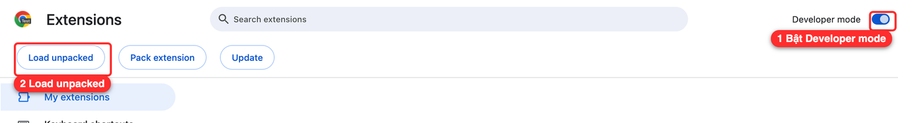

**4. Kiểm tra.** Thẻ **BoxLift: LiDAR ↔ Camera for CVAT** xuất hiện và công tắc đang bật là xong.

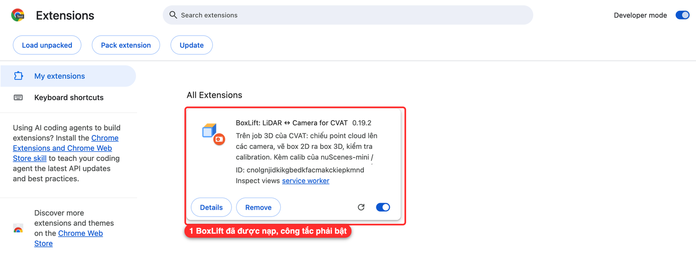

**Cập nhật bản mới:** tải zip mới, giải nén đè lên thư mục cũ (hoặc ra thư mục mới rồi *Load unpacked* lại), sau đó bấm
nút ⟳ trên thẻ BoxLift và tải lại trang CVAT.

## Hướng dẫn sử dụng

Mọi ảnh dưới đây chụp trên dữ liệu thật (nuScenes scene-0061 trên CVAT local). Khung đỏ đánh số khớp với phần chú thích
bên dưới mỗi ảnh.

### Bước 1. Mở BoxLift trên job 3D

Đăng nhập CVAT, mở một **job 3D**, chờ point cloud tải xong. Nút **Mở BoxLift** nằm ở góc phải dưới của trang.

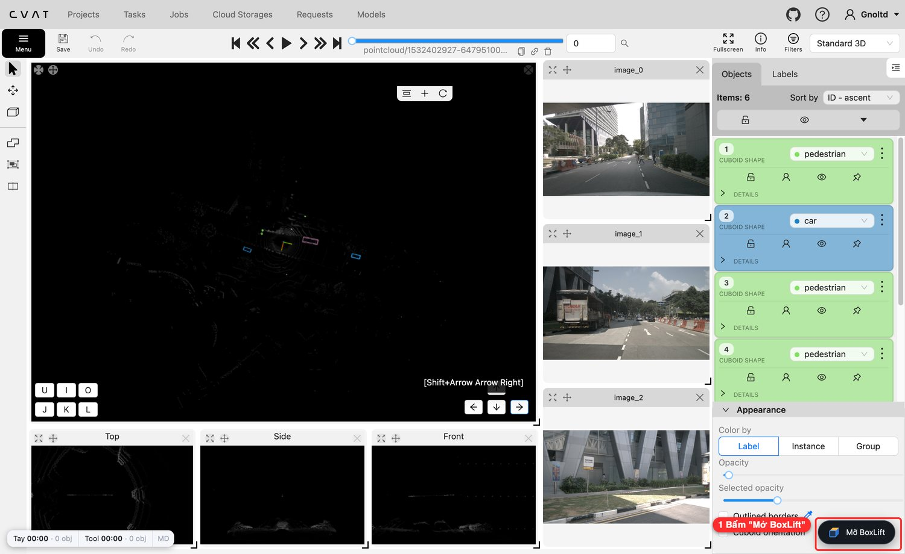

1. Bấm **Mở BoxLift**. Lần đầu sẽ hiện hộp *Bắt đầu với BoxLift* tóm tắt 4 bước; bấm **Bắt đầu vẽ** (hoặc `Enter`).
   Mở lại hộp này bất cứ lúc nào bằng `?`.

Extension lấy point cloud và ảnh camera của frame đang xem qua API CVAT bằng **phiên đăng nhập của bạn**, không cần nhập
mật khẩu.

### Bước 2. Làm quen màn hình chính


1. **Chọn camera.** Mỗi tab là một camera (Back, Front, Front Left, …). Đổi nhanh bằng phím `1`–`6`.
2. **Thanh công cụ trái.** `Chọn` (V), `Vẽ box` (N), kiểu lưu `Shape` / `Track`, `Tự động` (T), `Track 3D` (Shift+K), bật tắt
   điểm LiDAR (H).
3. **Thanh frame.** Kéo thanh trượt hoặc bấm `D` (lùi) / `F` (tới) giống CVAT.
4. **Danh sách box** của frame hiện tại, mỗi box có nhãn và trạng thái *Đã lưu*. Bấm một dòng để mở box đó.
5. **Đồng hồ phiên.** Chip thời gian làm việc và số box, xem [Bước 7](#bước-7-đo-thời-gian-làm-việc).
6. **Trạng thái lưu.** `Đã lưu` nghĩa là mọi thay đổi đã nằm trong job CVAT.

Các chấm màu trên ảnh là **điểm LiDAR chiếu lên camera** (màu theo khoảng cách). Box trắng là box đã có trong job.

### Bước 3. Kéo khung 2D để dựng box 3D

Chọn nhãn ở ô **Nhãn (class)**, bấm `N`, rồi **kéo một khung chữ nhật quanh vật thể** trên ảnh. Khung nên ôm sát vật thể;
vật thể bị che một phần thì vẫn kéo trọn hình dạng dự đoán của nó.

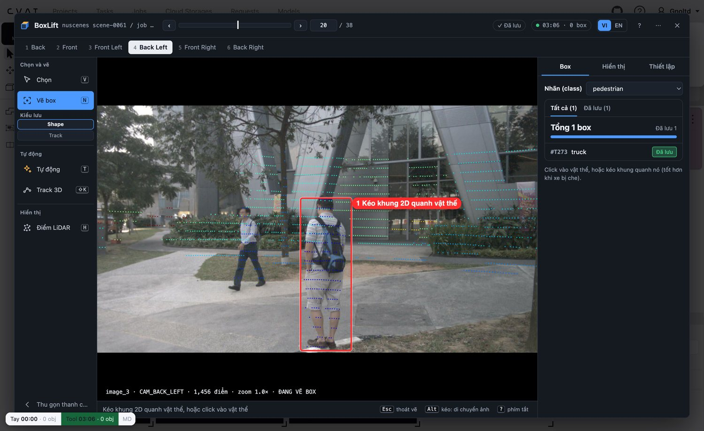

1. Khung 2D (khung đỏ) ôm trọn người đi bộ. Nhả chuột là xong.

### Bước 4. Chỉnh và lưu box

Box 3D hiện ra ngay trên ảnh, kèm 3 khung nhìn từ trên, từ hông và từ trước để kiểm tra điểm LiDAR có nằm gọn trong box.

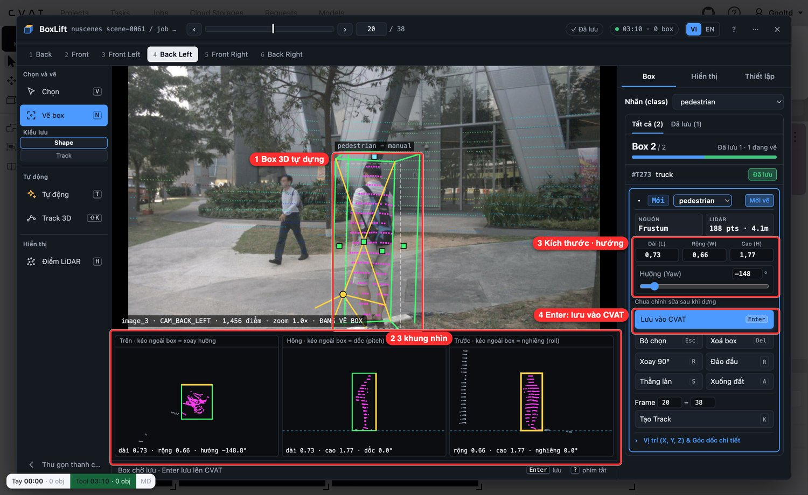

1. **Box 3D tự dựng** từ 188 điểm LiDAR trong khung. Kéo ô vuông trắng để dời một mặt, tròn vàng để xoay hướng.
2. **3 khung nhìn** Trên / Hông / Trước: kéo cạnh để đổi kích thước, kéo ngoài box để xoay.
3. **Kích thước và hướng** (Dài, Rộng, Cao, Yaw) hiển thị số thật, gõ trực tiếp để sửa.
4. **`Enter` để lưu** box vào job CVAT. Bỏ box bằng `Esc`, xoá bằng `Del`.

Các thao tác chỉnh hay dùng: `←↑↓→` dời 10 cm (giữ `Shift` thì 50 cm), `[` `]` xoay 1°, `R` xoay 90°, `S` thẳng theo làn,
`A` hạ xuống mặt đất. Xem đủ bảng bằng `?`.

### Bước 5. Để máy tự đề xuất box (T / Shift+T)

Bấm **`T`** để máy tự khoanh mọi vật thể trên camera đang xem, hoặc **`Shift+T`** để chạy trên **cả 6 camera**. Mỗi
vật thể thành một đề xuất, bạn chỉ **duyệt**: đúng thì lưu, sai thì bỏ.

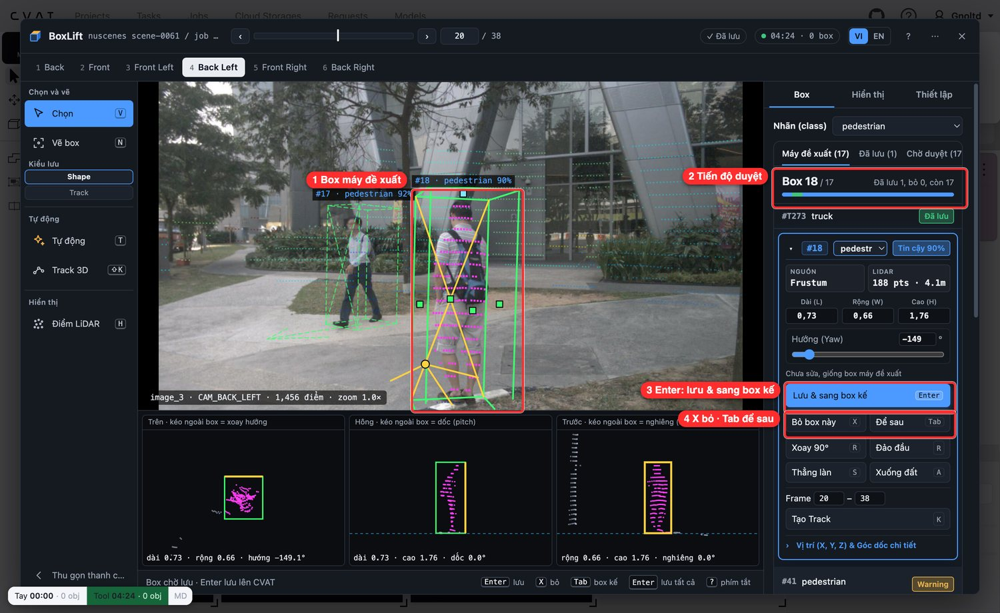

1. **Box máy đề xuất** hiện nét liền (đang duyệt) và nét đứt (chờ duyệt), kèm loại vật thể và độ tin cậy (92 %, 90 %).
2. **Tiến độ duyệt:** đang ở box 18 trên 17 đề xuất, đã lưu 1, bỏ 0, còn 17.
3. **`Enter`: lưu và sang box kế.** Box giữ nguyên thì không cần sửa gì thêm.
4. **`X` bỏ box này, `Tab` để sau.** Box sai nhãn hoặc không phải vật thể cần gán thì bỏ.

Mẹo: bấm `Shift+Enter` để **lưu tất cả** đề xuất còn lại khi bạn đã xem lướt và thấy ổn. Nút **Ngưỡng theo loại…** cho phép
nâng ngưỡng tin cậy từng loại để bớt đề xuất nhiễu.

### Bước 6. Track 3D: bám vật thể qua nhiều frame

Vật thể xuất hiện qua nhiều frame thì không cần dựng lại từng frame. Sau khi có box ở frame đầu, bấm **`Shift+K`**.

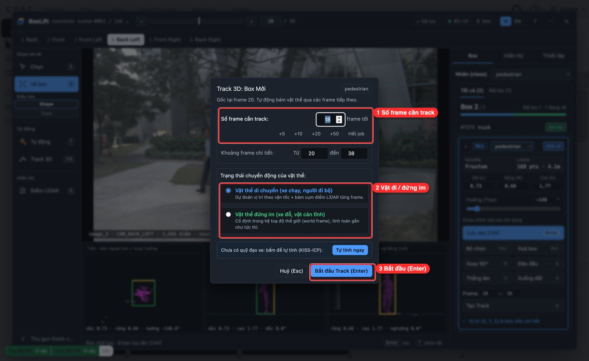

1. **Số frame cần track:** gõ số frame, hoặc bấm `+5`, `+10`, `+20`, `+50`, `Hết job`.
2. **Trạng thái chuyển động:** *di chuyển* (xe chạy, người đi bộ) thì dự đoán theo vận tốc và bám cụm điểm LiDAR; *đứng im*
   (xe đỗ, vật cản) thì cố định trong hệ toạ độ thế giới, tính gần như tức thì.
3. **Bắt đầu Track (`Enter`).** Box được lưu thành **track CVAT** giữ nguyên ID qua các frame. Khi cần sửa, đứng ở frame
   bất kỳ, sửa box rồi bấm `K` để đặt keyframe, các frame giữa hai keyframe tự nội suy lại.

Thanh frame tô màu theo trạng thái: **đỏ** là keyframe của bạn, **vàng** là đoạn nằm giữa hai keyframe đỏ, **xanh lá** là
đoạn sau keyframe cuối do 3D Track tính, không cần sửa. Bấm `0` để ra khỏi khung hiện tại hoặc quay lại.

> Lần đầu dùng Track với vật thể **di chuyển**, nếu chưa có quỹ đạo xe, bấm **Tự tính ngay** (KISS-ICP) trong hộp thoại.
> Máy tự suy ra chuyển động của xe thu từ các frame LiDAR, mất vài giây.

### Bước 7. Đo thời gian làm việc

BoxLift tự đo để lập bảng **Làm tay vs Dùng tool**, không cần bấm gì.

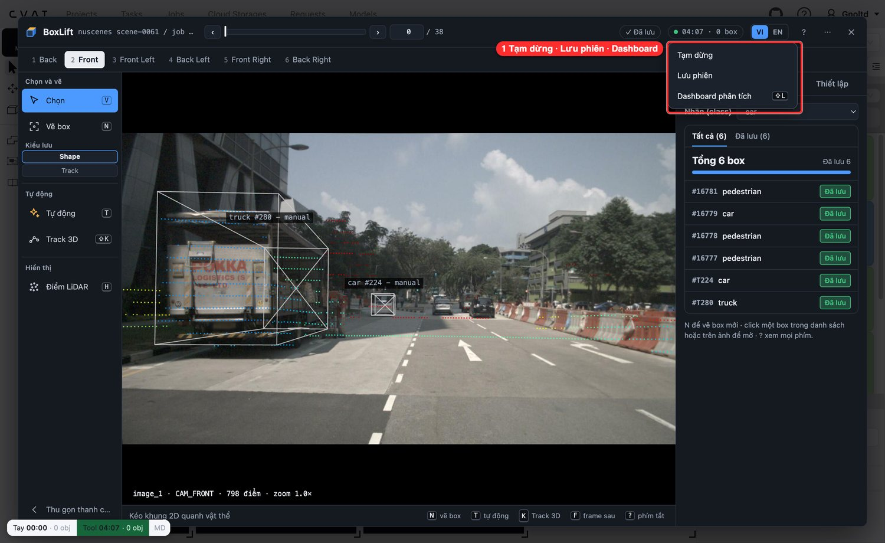

1. Bấm vào chip đồng hồ (`03:23 · 0 box`) để **Tạm dừng**, **Lưu phiên**, hoặc mở **Dashboard phân tích** (`Shift+L`).
   Dashboard hiển thị thống kê của phiên; tab **Thiết lập** có nút **Xuất CSV** để đưa số liệu vào báo cáo.

Chip nổi ở góc trái dưới trang CVAT (`Tay 00:00 · 0 obj | Tool 03:23 · 0 obj`) so sánh trực tiếp: **Tay** là thời gian bạn
gán thẳng trên CVAT, **Tool** là thời gian làm trong BoxLift, kèm số vật thể của mỗi bên.

### Mục phụ cần biết

**Tab Hiển thị** chỉnh cách vẽ điểm LiDAR (cỡ điểm, độ đậm, màu theo độ xa, ẩn mặt đất `G`, bật tắt 3 khung nhìn `Shift+V`).

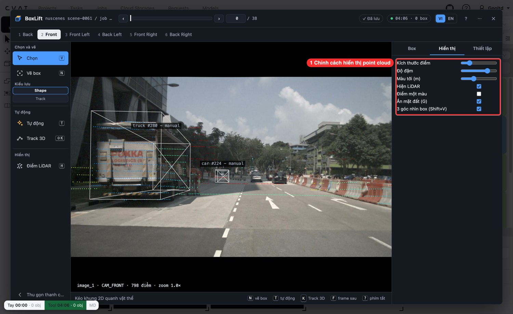

**Phím tắt:** bấm `?` bất cứ lúc nào để mở bảng phím tắt đầy đủ.

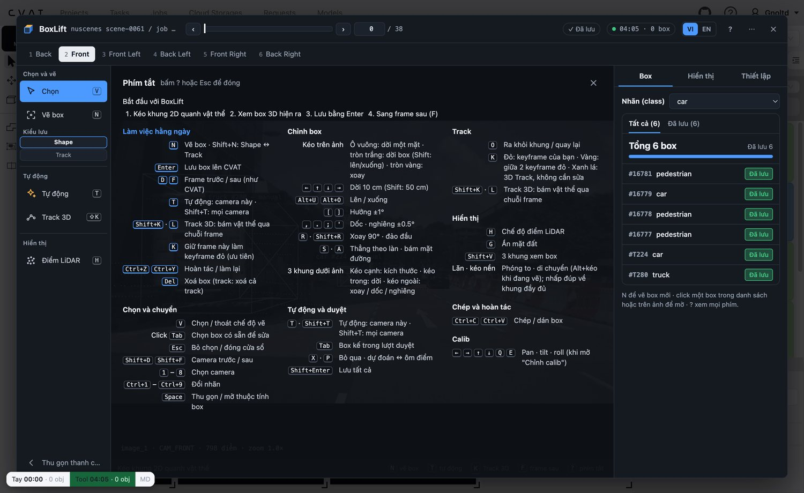

**Trang Cài đặt** (bấm biểu tượng BoxLift trên thanh công cụ Chrome): thêm domain CVAT riêng, quản lý calib, cấu hình nhật ký.

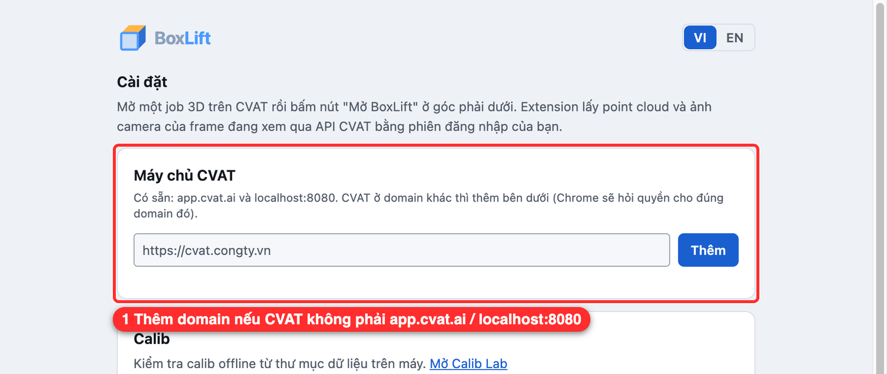

## Phím tắt cần nhớ

| Phím | Việc |
|---|---|
| `N` | Vẽ box (kéo khung 2D) · `Shift+N` đổi Shape ↔ Track |
| `Enter` | Lưu box lên CVAT · `Shift+Enter` lưu tất cả đề xuất |
| `T` / `Shift+T` | Tự động cho camera này / mọi camera |
| `Shift+K` | Track 3D · `K` đặt keyframe |
| `D` / `F` | Frame trước / sau |
| `1`–`8` | Chọn camera · `Shift+D` / `Shift+F` camera trước / sau |
| `X` · `Tab` | Bỏ đề xuất · để sau |
| `Ctrl+Z` / `Ctrl+Y` | Hoàn tác / làm lại |
| `Del` | Xoá box (box thuộc track thì xoá cả track) |
| `H` · `G` | Bật tắt điểm LiDAR · ẩn mặt đất |
| `?` · `Esc` | Bảng phím tắt · thoát / đóng |

## Xử lý sự cố thường gặp

| Hiện tượng | Cách xử lý |
|---|---|
| Không thấy nút **Mở BoxLift** | Phải là **job 3D** (không phải 2D). Tải lại trang (`F5`). Vào `chrome://extensions` kiểm tra công tắc BoxLift đang bật. |
| CVAT ở domain riêng, không có nút | Bấm biểu tượng BoxLift (hoặc mở trang Cài đặt) → **Máy chủ CVAT** → nhập `https://cvat.congty.vn` → **Thêm** → cho phép trong hộp thoại Chrome → tải lại CVAT. |
| Báo *task chưa có calib* hoặc box lệch xa | Tên task phải chứa tên cảnh có sẵn (`scene-0061`, …). Dữ liệu khác: mở **Thiết lập → Chỉnh calib** rồi nạp `calib.json`. |
| Báo thiếu mô hình / lỗi tải `.onnx` | Bạn đã tải nhầm *Source code (zip)*. Tải lại đúng `calib-overlay-v….zip` ở mục *Assets*. |
| MTrans chậm hoặc không chạy | Cần WebGPU (`chrome://gpu`). Không có thì BoxLift tự dùng Frustum PointNet, chất lượng xe con thấp hơn. |
| Box lan qua frame nhưng đứt ID | Chọn kiểu lưu **Track** (không phải Shape) trước khi vẽ để box lưu thành track CVAT. |
| Cập nhật bản mới mà vẫn thấy bản cũ | Bấm ⟳ trên thẻ BoxLift ở `chrome://extensions`, rồi tải lại trang CVAT. |

## Độ chính xác đã đo

Đo trên 2 cảnh nuScenes không dùng để học (0103, 0916), khung 2D là hình chiếu box đáp án ±3 px. Công cụ đo:
`tools/public/eval_boxes.js` và `tools/public/metrics.py`, nhật ký mọi lần đo ở `tools/public/NHAT-KY-DO.md`.

| Xe con (827 box) | IoU 3D ≥ 0,5 | IoU 3D ≥ 0,7 | Lệch tâm p50 | Hướng 360° ≤ 10° |
|---|---|---|---|---|
| 0.16.0 (chỉ hình học) | 54 % | 28 % | 0,47 m | 62 % (mọi xe) |
| 0.18.0 (Frustum PointNet) | 77,4 % | 46,4 % | 0,24 m | 79,1 % |
| **0.19.0 (MTrans)** | **92,3 %** | **73,5 %** | **0,18 m** | **82,8 %** |

Tốc độ (Mac, Chrome): MTrans khoảng 70 ms mỗi xe trên WebGPU; một lượt `Shift+T` trên 6 camera khoảng 0,4 s cộng thời gian
mô hình box. **Thời gian người mỗi cuboid trên CVAT local: chưa đo xong**, xem `tools/public/time_study.py`.

## Giới hạn hiện tại

- Chỉ đo trên dữ liệu công khai (nuScenes, KITTI); chưa có đáp án cho camera fisheye và LiDAR dày.
- MTrans chỉ học xe con và cần WebGPU. Mô hình được chọn trên chính 2 cảnh đo nên số liệu có thể hơi lạc quan.
- Calib phải chuẩn (khoảng ≤ 0,5° và 10 cm); mô hình học trên calib đúng.
- Vật xa, bị che nhiều hoặc rất ít điểm LiDAR (vài điểm) cho box kém tin cậy, extension sẽ cảnh báo *Ít điểm LiDAR* để bạn kiểm tra.
- Box lan qua frame bằng kiểu lưu **Shape** là shape riêng từng frame nên **mất ID**; dùng kiểu **Track** để giữ ID.
- Mô hình `extension/models/*.onnx` nặng khoảng 130 MB (mtrans.onnx 84 MB).

## Hướng phát triển

Các ý tưởng ngoài phạm vi MVP, chưa làm:

- Hỗ trợ camera fisheye và LiDAR dày; thêm bộ dữ liệu ngoài nuScenes / KITTI.
- Mở rộng MTrans cho xe tải, buýt, người.
- Phát hành lên Chrome Web Store để cài một cú bấm, không cần Developer mode.
- Hoàn tất đo thời gian người làm tay và lập bảng so sánh Làm tay vs Dùng tool trên dữ liệu thật.

## Dành cho người phát triển

<details>
<summary>Chạy từ mã nguồn, test, đóng gói release</summary>

```bash
# 1. Extension: Chrome → chrome://extensions → Developer mode → Load unpacked → chọn thư mục extension/
#    (mô hình .onnx không có trong git; tải từ release hoặc chạy bước đóng gói ở dưới)

# 2. Môi trường cho công cụ dữ liệu / đo (Python 3.12, Node 18+)
python3 -m venv .venv && .venv/bin/pip install numpy scipy opencv-python pillow torch onnx

# 3. Dữ liệu công khai để NGOÀI repo, ví dụ ~/public-data/ (nuScenes, KITTI: phải đăng ký, tự tải)
.venv/bin/python tools/public/nuscenes_to_cvat.py --root ~/public-data/nuscenes --scene scene-0061 \
    --out ~/public-data/cvat-upload/nuscenes-0061-key

# 4. Tạo task trên CVAT local (tên task chứa tên cảnh → extension tự chọn calib); tài khoản lấy từ biến môi trường
CVAT_USER=... CVAT_PASSWORD=... .venv/bin/python tools/public/cvat_upload.py ~/public-data/cvat-upload/nuscenes-0061-key

# 5. Test (chạy trước khi gộp code)
for t in tests/*.test.js; do node $t; done

# 6. Đóng gói release: extension + mô hình, có kiểm SHA256 → dist/calib-overlay-vX.Y.Z.zip
node tools/pack.js
```

**Đóng gói release:** `node tools/pack.js` tải mô hình còn thiếu từ release của repo này và kiểm SHA256. File zip **bắt buộc** chứa đủ
`extension/models/*.onnx` (`frustum_box`, `frustum_seg`, `heading`, `mtrans`, `yolox_s`), `frustum.json` và `SHA256SUMS`,
vì `.onnx` nằm trong `.gitignore` và không có trong mã nguồn.

Tài liệu thiết kế: [`PLAN.md`](PLAN.md), [`RESEARCH.md`](RESEARCH.md).

</details>

## Ghi công và giấy phép

- Tác giả: Đỗ Thành Long (cùng nhóm Cohort 4A).
- Mô hình học trên dữ liệu **CC BY-NC-SA** nên chỉ dùng **phi thương mại**. Nguồn dữ liệu, mô hình và giấy phép chi tiết:
  [`extension/THIRD_PARTY.md`](extension/THIRD_PARTY.md).
- Dựa trên [CVAT](https://github.com/cvat-ai/cvat), [nuScenes](https://www.nuscenes.org/), KITTI, ONNX Runtime Web và YOLOX.
