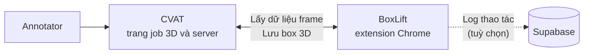
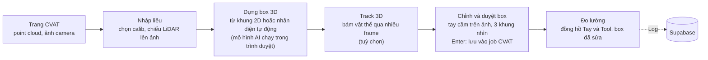
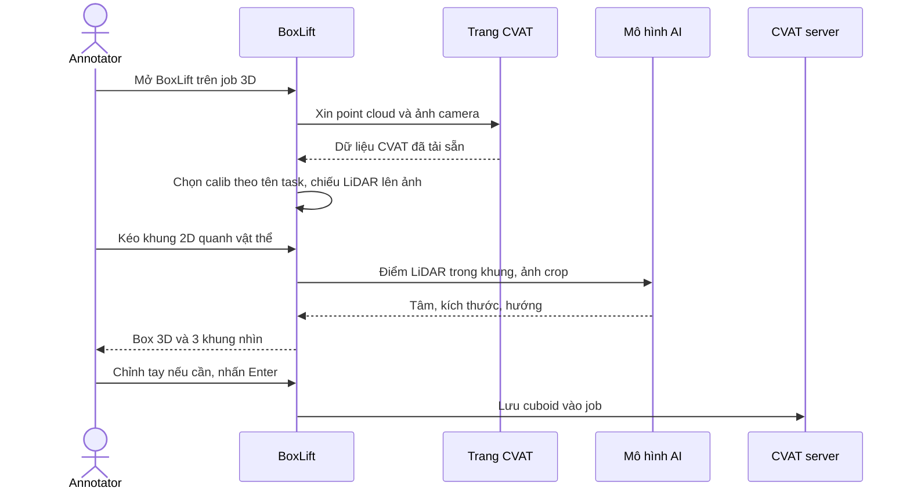
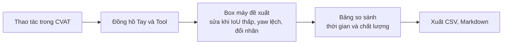
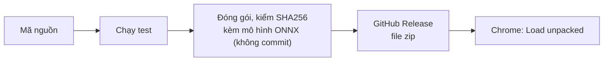
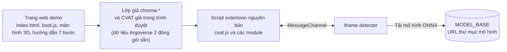

# BoxLift: sơ đồ kiến trúc

BoxLift là extension Chrome (Manifest V3) chạy trên job 3D của CVAT. Toàn bộ tính toán nằm trong trình duyệt của annotator;
dữ liệu chỉ đi giữa trang CVAT và extension. Chỉ log thao tác và quỹ đạo xe (không có ảnh, không có point cloud) được đẩy lên Supabase,
và chỉ khi extension đã được cấu hình URL và khoá Supabase (`config/database.json`, không commit); mất mạng thì log
xếp hàng trong `chrome.storage` rồi gửi lại.

Tài liệu này mô tả bản `0.19.2`.

## 1. Bối cảnh hệ thống

## 2. Các khối chức năng

## 3. Luồng chính: kéo khung 2D ra box 3D, lưu vào CVAT

Xe con dùng MTrans (ảnh + LiDAR, cần WebGPU), xe tải, buýt, xe đạp và người dùng Frustum PointNet (chỉ LiDAR), xe máy và
các trường hợp dự phòng dùng gom cụm hình học. Phím `T` thêm một bước ở đầu: mô hình nhận diện tự khoanh vật thể, mỗi khung
đi qua luồng trên như một khung kéo tay. `Shift+K` (Track 3D) lặp luồng này theo frame.

Calib được chọn theo thứ tự: calib đã lưu cho task, rồi khớp **tên task** với bộ calib có sẵn, rồi người dùng chọn tay hoặc
nạp `calib.json`.

## 4. Đo lường: Làm tay vs Dùng tool

## 5. Phát hành

## 6. Bản demo web

Trang tĩnh trên Vercel chạy nguyên mã extension, không sửa; chỉ thêm lớp giả `chrome.*` và CVAT giả trong trình duyệt.

Box vẽ trong demo chỉ lưu ở trình duyệt (`localStorage`); không có server nào nhận dữ liệu.

## Quyết định thiết kế

| Quyết định | Lý do |
|---|---|
| Mọi suy luận chạy trong trình duyệt (WebGPU hoặc WASM) | Không gửi ảnh và point cloud ra ngoài; không cần server GPU |
| Lấy frame CVAT đã tải qua plugin API của CVAT | Không tải point cloud hay ảnh lần hai, không cần mật khẩu |
| Mô hình chạy trong iframe ở origin của extension, nói chuyện qua `MessageChannel` | Trang CVAT không đọc được file mô hình hay dữ liệu suy luận |
| Cấu hình DB (`config/database.json`) chỉ đi qua service worker; trang web ngoài chỉ thấy 4 file của extension | Khoá DB không lộ cho trang; mô hình, calib và script không đọc được từ ngoài (xem mục Bảo mật trong [`dac-ta-thiet-ke.md`](dac-ta-thiet-ke.md)) |
| Mô hình chọn theo lớp vật thể, không theo tên nhãn | Job có thể gộp nhiều lớp vào một nhãn (có bước ánh xạ nhãn) |
| Supabase chỉ nhận log thao tác và quỹ đạo xe, mỗi máy là một danh tính đăng nhập ẩn danh | Phục vụ bảng số liệu Làm tay vs Dùng tool; RLS theo `auth.uid()` nên máy này không đọc được dữ liệu máy khác (chi tiết trong [`dac-ta-thiet-ke.md`](dac-ta-thiet-ke.md)) |

Tài liệu liên quan: [`PLAN.md`](../PLAN.md), [`RESEARCH.md`](../RESEARCH.md), [`extension/THIRD_PARTY.md`](../extension/THIRD_PARTY.md).
